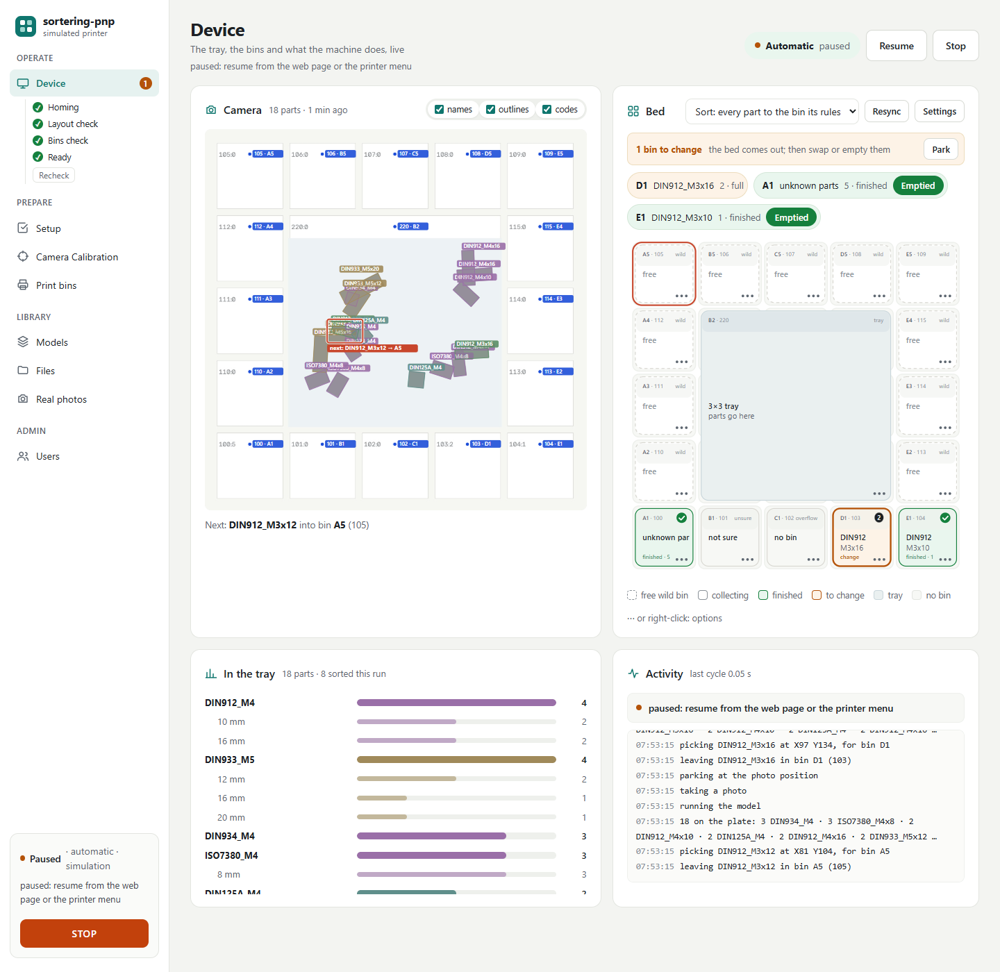
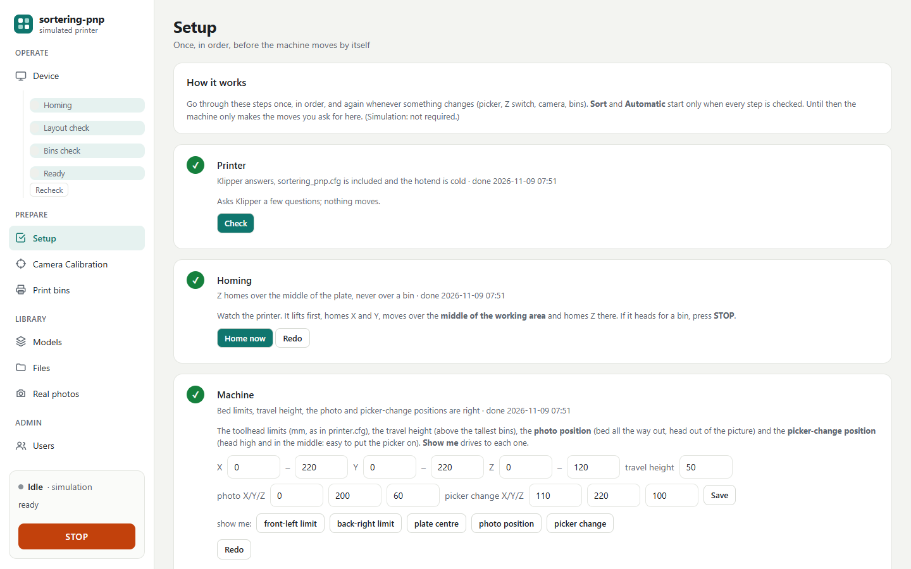
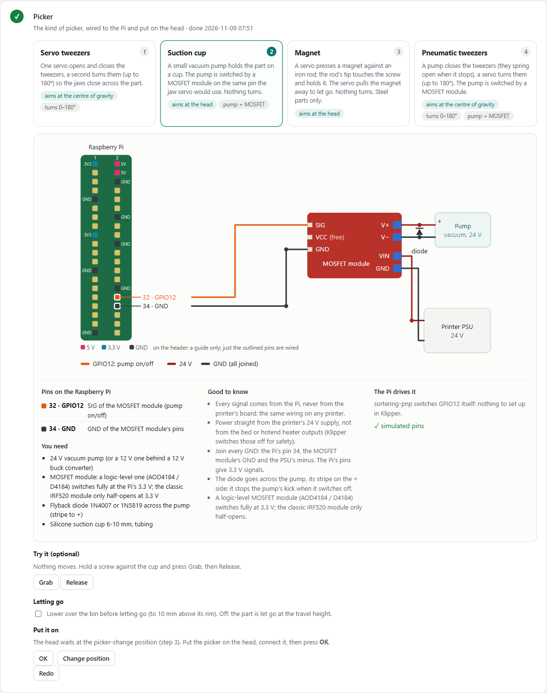
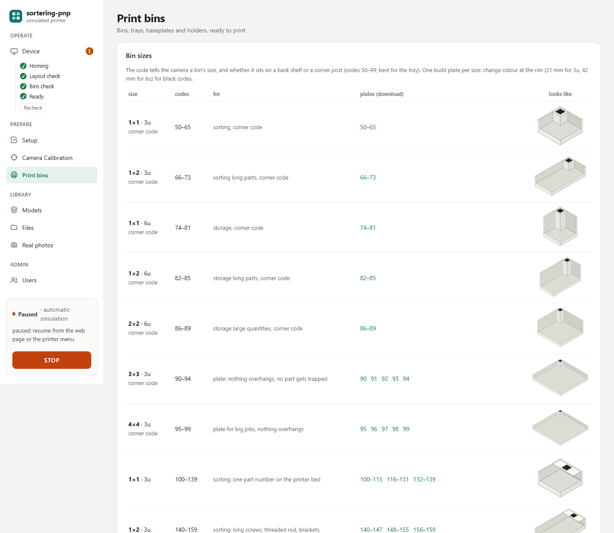
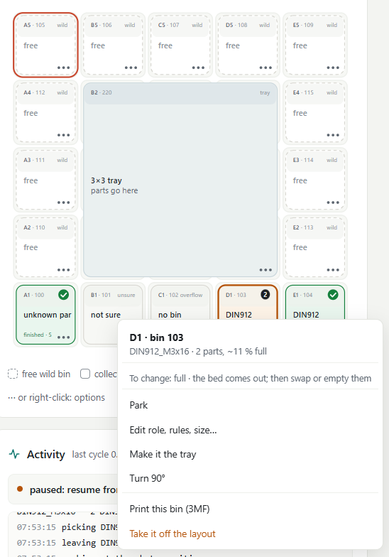
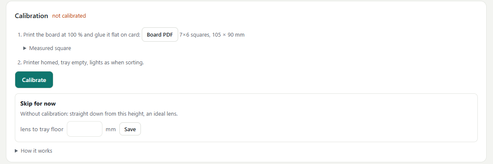
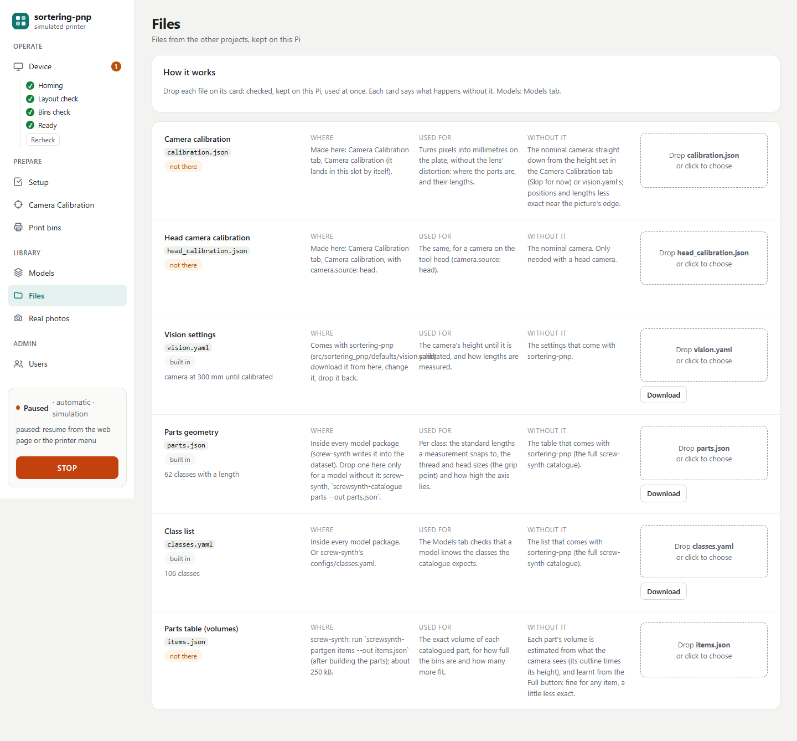
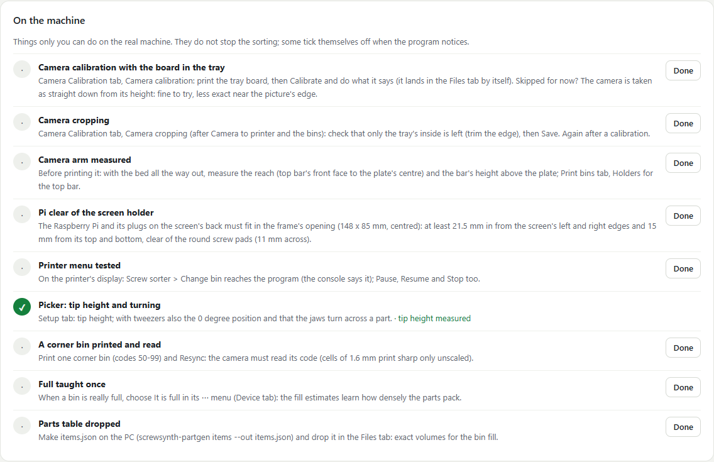
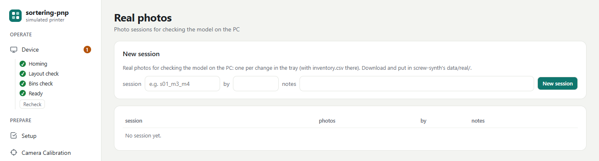

# sortering-pnp

**Turn a 3D printer into a screw sorter.** You throw a handful of screws, nuts and washers into a
tray on the printer bed. A camera looks at them, a trained model recognises each part (type, size
and length), and the printer picks them up one by one and drops each into its own bin.

sortering-pnp is the program that runs the machine. It lives on a Raspberry Pi next to Klipper (the
printer's firmware) and you use it from a web page on your phone or PC, or from the printer's own
display.


*The Device tab, the page you land on. On the left the sections of the page, grouped by what
you do (operate, prepare, library), and below them the machine: its state, what it is doing and
the STOP button. Anything that needs you, like a full bin, shows as an orange banner at the top
with its button. Top left the camera: the latest photo with every part
outlined and named, and the part picked next boxed in red. Top right the bed, live: every bin with
what it collects and how full it is; one bin waits for a change (amber), two are finished (green).
Bottom left what lies in the tray, by class and length; bottom right what the machine is doing.
(Pictures from the built-in simulator, which draws the bed instead of photographing it.)*

It is one of three projects that work together:

| Project | Runs on | Does |
|---|---|---|
| [screw-synth](https://github.com/ama24/screw-synth) | your PC | makes the training pictures, and the parts table that goes with them |
| [training-synth](https://github.com/ama24/training-synth) | your PC (GPU) | trains the model that recognises the parts |
| **sortering-pnp** (this one) | the Raspberry Pi | runs the machine: camera, decisions, printer, bins, web page |

The Raspberry Pi needs **only this one**. The projects only exchange files: the trained model
(from training-synth, for example as a download from its releases page) goes into sortering-pnp's
web page, and the camera calibration and real photos made here go back to screw-synth. Each
project works without the others.

### What's new

- **The Pi needs only sortering-pnp** (renamed from screwpick). The camera, calibration and
  measuring code now live here; the trained model, with its class list and parts table, comes as
  one package you upload in the Models tab. The sibling projects are now called screw-synth and
  training-synth.
- **The picker needs no Klipper set-up:** sortering-pnp switches the Raspberry Pi's pins itself,
  so there is no second Klipper board, no `make menuconfig` and nothing to install for it.
- **Four pickers to choose from** in the Setup tab: servo tweezers, suction cup, magnet,
  pneumatic tweezers. Each with its wiring to the Raspberry Pi drawn on the page.
  [The picker](#the-picker).
- **New look:** the sections are in a sidebar on the left, grouped by what you do, with the
  machine's state and the STOP button always at its bottom. Every page has a title, and a full
  bin or unfinished setup shows as an orange banner at the top of Device.
  [Finding your way around the page](#finding-your-way-around-the-page).
- **Device tab:** one page with the live camera (every part outlined, the next one boxed), the
  live bed with a menu on every bin, what lies in the tray, and what the machine is doing.
  [See below](#first-time-setup).
- **Change bin:** a full bin turns amber and gets a *Change bin* button, on the page and on the
  printer. The machine keeps sorting the rest meanwhile. [Everyday use](#everyday-use).
- **Queued bin changes:** edit, add, turn or take off bins, then *Apply* them all at once, even
  while sorting.
- **Camera calibration and real photos from the page** (Calibrate and Real photos tabs): sortering-pnp is
  the only program that moves the printer.
- **Files tab:** one row per file from the other projects, each with its drop area.
- **Faster page:** the Pi answers on IPv6 and IPv4 and no longer re-reads files every second.

---

## Contents

- [How it works, in one minute](#how-it-works-in-one-minute)
- [What you need](#what-you-need)
- [Install](#install)
- [First-time setup](#first-time-setup)
- [Everyday use](#everyday-use)
- [How it works, in more detail](#how-it-works-in-more-detail)
- [Real photos for checking the model](#real-photos-for-checking-the-model)
- [Updating](#updating)
- [On a PC](#on-a-pc)
- [More](#more)

---

## How it works, in one minute


1. **The bed.** A grid of [Gridfinity](https://gridfinity.xyz/) bins sits on the bed. One big bin,
   the **tray**, is where you throw the parts; the small bins around it receive the sorted parts.
   Every bin carries a small black-and-white code, so the camera finds the bins by itself, wherever
   you put them.
2. **A photo.** The camera above the bed takes a picture. Only the inside of the tray is shown to
   the model, so the bins around it can't confuse it.
3. **Recognising.** The model outlines every part and names it (for example `DIN912_M4`, a socket
   head screw M4). For screws it also measures the length (`DIN912_M4x16`).
4. **Deciding.** sortering-pnp counts what is in the tray and starts with the most numerous kind. Each
   kind goes to the bin you assigned it, or claims a free bin by itself.
5. **Picking.** The printer moves the picker (tweezers, a gripper or a small suction cup) over the
   part, at the right angle, takes it and drops it into its bin. While it carries the part, the Pi
   already looks at the next photo.
6. **Again**, until the tray is empty. Bins that are full or finished are shown on the page and on
   the printer display; you empty or swap them and press **Change bin**.

---

## What you need

**Hardware**

- A **3D printer running Klipper** with Moonraker (e.g. an Ender 3 or a Prusa MK3 with MainsailOS
  or a KIAUH install). The hotend comes off; a **picker** goes on in its place, wired to the
  Raspberry Pi's own pins. Four kinds, chosen in the Setup tab:

  | Picker | Holds the part with | Aims at | Turns |
  |---|---|---|---|
  | **Servo tweezers** | a servo closing the tweezers | the centre of gravity (on the shank) | yes, a second servo, 0–180° |
  | **Suction cup** | a vacuum pump, switched by a MOSFET module | the head | no |
  | **Magnet** | a servo pressing a magnet against an iron rod | the head | no |
  | **Pneumatic tweezers** | a pump, switched by a MOSFET module | the centre of gravity | yes, a servo, 0–180° |
- A **Raspberry Pi 4 or 5** with 4 GB or more, running 64-bit Raspberry Pi OS. It runs Klipper,
  the camera, the model and the web page together.
- A **Raspberry Pi Camera Module 3** about 300 mm above the bed, looking straight down.
- Even **lighting** over the bed (an LED strip under a simple shroud works well).
- A **matte TPU sheet** (blue or green), cut to the tray's floor: parts don't bounce on it and the
  camera sees them clearly.

**Printed parts** (all ready in [prints/](prints/), or made for your own layout in the page's
*Print bins* tab):

- a Gridfinity **baseplate** for the bed (thin versions that clamp to a whole Ender 3 or MK3 bed),
- the **tray** (3 × 3 or 4 × 4 cells) and **bins**, with their codes,
- a **camera arm** (plain, or with an LED ring light round the lens) and a **screen holder** for
  the printer's top bar (for the Pi with a 7" screen).

See [prints/README.md](prints/README.md) for which files to print and how.

---

## Install

1. **Install Klipper, Moonraker and Mainsail** (skip this if you flashed the MainsailOS image: they
   are already there). On a fresh Raspberry Pi OS, with [KIAUH](https://github.com/dw-0/kiauh):

   ```bash
   sudo apt-get install -y git
   git clone https://github.com/dw-0/kiauh.git ~/kiauh
   ~/kiauh/kiauh.sh
   ```

   In its menu choose **Install**, then **Klipper**, **Moonraker** and **Mainsail** one after
   the other (the defaults are fine). Then make Klipper drive your printer:
   - **Firmware:** the settings for your board are at the top of its example config in
     `~/klipper/config/` (`ls ~/klipper/config | grep -i ender3`). Choose them in
     `cd ~/klipper && make clean && make menuconfig`, then `make`. A 32-bit board (e.g.
     Creality 4.2.x) takes `out/klipper.bin` from an SD card. An older 8-bit board (e.g. the
     Ender 3's 1.1.x, ATmega1284p, 16 MHz) is flashed over USB:
     `sudo service klipper stop && make flash FLASH_DEVICE=$(ls /dev/serial/by-id/* | head -1) && sudo service klipper start`.
   - **printer.cfg:** replace KIAUH's placeholder with that example, keeping its first line, e.g.
     for an Ender 3 with the 1.1.x board:

     ```bash
     cd ~/printer_data/config && mv printer.cfg printer.cfg.kiauh
     { echo "[include mainsail.cfg]"; cat ~/klipper/config/printer-creality-ender3-2018.cfg; } > printer.cfg
     ```

     Then set `[mcu] serial:` to what `ls /dev/serial/by-id/*` shows (Mainsail, *Machine* tab).
   - **Check:** in Mainsail the printer is *Ready*; `STEPPER_BUZZ STEPPER=stepper_x` (and `_y`,
     `_z`) moves each motor +1 mm first; `QUERY_ENDSTOPS` shows each switch; then home.

   More in [Klipper's installation guide](https://www.klipper3d.org/Installation.html).
2. **Install sortering-pnp:**

   ```bash
   git clone https://github.com/ama24/sortering-pnp.git ~/sortering-pnp
   ~/sortering-pnp/install-pi.sh --service
   ```

   The script installs everything in one go, with **exact, checked versions** of every package,
   so an install today and one next year give the same program. Nothing else is downloaded: the
   camera, calibration and measuring code are part of sortering-pnp.
   `--service` starts sortering-pnp at every boot.
3. **Tell Klipper about the sorter:**

   ```bash
   cp ~/sortering-pnp/klipper/sortering_pnp.cfg ~/printer_data/config/
   echo "[include sortering_pnp.cfg]" >> ~/printer_data/config/printer.cfg
   ```

   Run the `echo` line only once. Then **FIRMWARE_RESTART** in Mainsail. That is all Klipper
   needs: the picker isn't in Klipper at all, sortering-pnp switches the Pi's pins itself (see
   [The picker](#the-picker) below).
4. **Open the page:** `http://<your-pi>:8080` on your phone or PC. The first visit asks you to
   create an account.

From now on **sortering-pnp is the only program that moves the printer**. Even the camera calibration
photos are taken from its page.

### Finding your way around the page

The sections are in the sidebar on the left, grouped by what you do:

| Group | Section | What it's for |
|---|---|---|
| Operate | **Device** | the machine live: camera, bed, what's in the tray, what it's doing. You land here. |
| Prepare | **Setup** | the steps to do once, in order, before the machine moves by itself |
| | **Calibrate** | the camera, the camera to the printer, and the picker tip |
| | **Print bins** | the bins, trays, baseplates and holders to print |
| Library | **Models** | the models that find and measure the parts |
| | **Files** | files from the other projects (calibration, parts table) |
| | **Real photos** | photo sessions for checking the model on the PC |
| Admin | **Users** | who may use the page |

An orange number next to a section means it needs you (a bin to change, setup steps left). At
the bottom of the sidebar is the machine: its state, what it is doing, and **STOP**. On a phone
the sidebar becomes a bar across the top.

---

## First-time setup

Until the setup is complete, the machine only makes the moves you ask for on the Setup tab;
**Sort** and **Automatic** stay locked.

### 1. The Setup tab



Go through the seven steps once, in order:

1. **Printer:** sortering-pnp asks Klipper a few questions (is `sortering_pnp.cfg` included, is the
   hotend cold). Nothing moves.
2. **Homing:** press *Home now* and watch. sortering-pnp lifts the head first, then homes Z over the
   middle of the tray, never over a bin.
3. **Machine:** the bed limits, the travel height, the **photo position** (bed all the way out,
   head out of the picture) and the **picker-change position** (head high and in the middle).
   *Show me* drives to each so you can check. *Confirm* then sends the head to
   the picker-change position, ready for the next step.
4. **Picker:** choose yours and wire it as the page shows (sortering-pnp switches the Pi's pins
   itself, see [The picker](#the-picker)). *Grab* and *Release* try it if you like. Put it on the
   head and press **OK**: from then on sorting may move it.
5. **Tip height:** *Go to centre*, then jog the tip down with the Z buttons on the same row
   until a sheet of paper just drags, and press *Set height*. Every height
   sortering-pnp uses counts from here.
6. **Camera to printer:** *Take photo* shows what the camera sees, with every code it reads
   circled and named (no model needed). Jog the tip onto the centre of three codes far apart,
   press *Tip is here* on each, then *Fit*. Do the **Camera calibration** (Camera Calibration tab, step 3
   below) before it.
7. **Layout:** *Find bins*: one photo finds the grid, every bin and which way it faces (see
   step 2 below).

A step un-checks itself when something it depends on changes, so the setup can't silently go
stale.

### The picker



In the **Setup tab → Picker**, choose one of four (numbered in this order):

1. **Servo tweezers:** one servo opens and closes them, a second turns them up to 180°.
2. **Suction cup:** a vacuum pump, switched on and off by a MOSFET module.
3. **Magnet:** a servo presses a magnet against an iron rod; the rod's tip holds the screw. Steel
   only.
4. **Pneumatic tweezers:** a pump closes them, a servo turns them up to 180°.

The cup and the magnet are put on the screw's **head**. Both tweezers close at the **centre of
gravity**, on the shank, turned across the part.

Every signal comes from the **Raspberry Pi**, never from the printer's board, so the wiring is
the same on any printer. sortering-pnp runs on that Pi and switches the pins itself: nothing to
set up in Klipper. The page draws the wiring for the type you chose:

| Pi pin | Does |
|---|---|
| 32 (GPIO12) | grabs: the jaw servo, the magnet servo, or the MOSFET module's SIG (pump on/off) |
| 33 (GPIO13) | turns: the rotation servo (tweezers only) |
| 34 (GND) | joined with the ground of the 5 V converter, the MOSFET module and the 24 V supply |

Power comes straight from the printer's 24 V supply, as part of the conversion:

- **Servos:** run a pair of wires from the 24 V supply to the tip and put a small 5 V buck
  converter there, next to the servos. Never power them from the Pi's 5 V pin.
- **Pumps:** they run from the 24 V supply through the MOSFET module, with a diode across the pump.
  A logic-level module (AOD4184 / D4184) switches fully at the Pi's 3.3 V; the classic IRF520
  module only switches halfway.
- **Not the heater outputs:** don't take power from the bed or hotend heater outputs. Klipper
  switches them under its heater safety checks.

The page says whether the pins are ready. A pump is a plain on/off pin and needs nothing more.
Servos use the Pi's hardware PWM, which `install-pi.sh` turns on (one line in `config.txt`;
reboot once after the first install). Try *Grab* and *Release*, and for tweezers *Turn to 0°*
and *90°*: at 0° the jaws must close left–right; if they don't, set the offset. Parts are let
go at the travel height; tick *Lower over the bin before letting go* to go down to `drop_mm`
above the bin's rim first (`picker.lower_to_drop`). Then put the
picker on the head (it waits at the picker-change position) and press **OK**. Servo angles and
pins can be changed in `configs/machine.yaml` (`picker:`).

### 2. Bins on the bed


*The Print bins tab starts with the corner bins (codes 50–99): the code sits on a square post
that goes straight down to the floor, so no part can get trapped under it. The post is in the
back-right corner; the pictures draw it in the far corner so you can see it. The shelf bins
(codes 100–239) follow below.*

Print the baseplate, a corner tray (codes 90–94) and some bins (the *Print bins* tab, or the ready-made files in
`prints/`). Bins come as two-colour files: white bin, black code. With a single-colour printer, add
a colour change at the rim height.

Put the baseplate anywhere on the bed, the tray and the bins anywhere on it, turned any way. Then
on the **Device** tab press **Resync** (next to the bed): one photo finds the grid, every bin and
which way it faces, and makes the biggest bin the tray.



Each bin shows its grid name (A1 is front-left), its code, what it collects, how many parts went
in and a bar for how full it is. Click a bin (or its **⋯**, or right-click it) for its menu: edit
its rules, make it the tray, turn it, ask for it to be changed, mark it full or emptied, print
it. A grey square is a cell without a bin; its ⋯ puts one there.

Leave a bin without rules and it is **wild**: it is claimed by the first new kind of part that
needs a bin. A layout of only wild bins sorts by itself.

Changes are **queued**: they show dashed, a bar lists them, and **Apply** saves them all at once
(even while the machine sorts: they count from its next pick). **Discard** forgets them.
**Settings** next to Resync holds the grid size and what a wild bin collects.
<br clear="right">

### 3. The camera



In the **Camera Calibration** tab:

1. **Camera:** the live picture from the camera, at the top. **Rotate 90°** / **Mirror** turn
   the picture (photos too); then do Camera to printer again. Focus, white balance, exposure and
   the image's look are set below it (Auto or Manual; **Autofocus** focuses once). The picture starts turned 180° (`camera.hflip`/`vflip: true`), for a camera
   mounted the other way round.
2. **Camera calibration** teaches the program how the camera sees. Download and print the small
   tray board, home the printer, empty the tray, then press **Calibrate**: one button. It parks
   the bed, locks the camera (measures the light and focus once and freezes them), then asks you
   to move the board slowly under the camera. Each time it holds still somewhere new, a photo is
   taken by itself, and the covered part of the live picture turns green. Then it asks you to
   lay the board flat in the tray, measures where the camera stands, and saves the result.
   **Skip for now:** enter the lens' height above the tray floor instead. The camera is then
   taken as looking straight down at the picture's centre; fine for trying things, less exact
   near the picture's edge. Calibrate later.
3. **Camera cropping:** the live picture next to what the model gets. Only the tray's inside goes
   to the model (YOLO); the rest is painted over with one colour (the tray floor's own, or one you
   pick). The bins and codes are always read from the whole photo. Set it once Camera to printer
   and the bins are done, and trim the edge with − / + until no wall is left.
4. **Camera to printer** is step 6 of the Setup tab: take a photo, jog the tip onto the centre
   of three codes, press *Tip is here* on each, then *Fit*. Now the program knows where every
   pixel is on the printer.

None of these needs a model: the photos only read the codes. The model is needed for sorting.

### 4. The model and the files

Download a trained model package (a `.zip` from training-synth, for example from its releases
page) and upload it in the **Models** tab (drag the file onto the page; old models are kept, so you
can switch back). The package also brings the class list and the parts table it was trained with. The **Files** tab takes the other files sortering-pnp can use. Each card says
where to find the file, what it's for and what happens without it:



None of them is required: without a parts table, for example, bin fill is estimated from what the
camera sees.

### 5. The last checks on the real machine

The Setup tab ends with a list of things only you can do on the real machine (measure for the
camera arm, test the printer menu, print a corner bin…). Some tick themselves off when the
program notices; they never block sorting.



---

## Everyday use

1. **Throw the parts into the tray** and spread them a little with your hand.
2. Press **Automatic** on the Device tab (or *Screw sorter → Automatic* on the printer's display).
   The machine waits until nothing moves any more, sorts until the tray is empty, then waits
   again: just keep throwing parts in. It looks again every minute, with the motors off so it's
   quiet. **Sort once** sorts what's there and stops.
3. **Watch the Device tab** if you like: the photo with the next part boxed, the bed, what lies
   in the tray, and a line for everything the machine does (parking, taking a photo, running the
   model, picking X, leaving X in bin Y).
4. **When a bin is full**, or a new kind needs a bin and none is free, the bin turns amber on the
   bed and an orange banner with a **Change bin E1** button appears at the top of the Device tab
   (and on the printer's display). The
   machine **keeps sorting everything else**.
   - Press **Change bin E1**: the machine parks with the bed out, so your hands are safe.
   - Empty the bin, or put an empty bin in its place, and press **Bin E1 changed**. A photo checks
     what is there now (the same bin emptied, another bin, or nothing) and sorting goes on.
   - You can also ask for any bin to be changed from its ⋯ menu.
5. **Finished bins** (nothing left in the tray goes there) are green, with an **Emptied** button
   under the bed. Take them out, empty them and press it.
6. **STOP**, at the bottom of the sidebar, stops the printer at once.

Everything on the page can also be done from the printer's display: **Screw sorter** in its
menu has Automatic, Sort, One pick, Change bin, Pause, Resume and Stop.

---

## How it works, in more detail

**Seeing.** The camera photographs the whole bed. The bin codes are read from that photo. Then
everything outside the tray's inside is painted over with the tray floor's colour, and only that
goes to the model: it was trained on pictures of parts on a plain plate, at a fixed size per
millimetre, and the photo keeps exactly that size. The camera calibration turns pixels into
millimetres; the camera-to-printer fit turns those into printer coordinates.

**Choosing what to pick.** The first photo of a batch counts the parts by kind. The most numerous
kind goes first and is finished before the next one starts. If a kind that was already done turns
up again (dug out from under others), the machine goes back to it first. Within a kind, a part
with free space around it comes first, so the picker doesn't knock the others.

**Choosing the bin.** Bins with your rules come first (a part number like `DIN912_M4x16`, a class
like `DIN912_M4`, a family like `DIN912`, or wildcards). Then wild bins: each collects the first
kind that claims it. Unknown parts go to the *unknown* bin, parts the model isn't sure about to
*unsure*. When no bin is left, the machine asks for a bin change: it picks a bin whose kind is
finished or which is nearly full.

**Picking.** For a screw the model finds the top of the head, the underside of the head and the
tip, so sortering-pnp knows which way it lies, how long it is and where its centre of mass is. Tweezers
turn to close across the shank at that point; a suction cup or a magnet goes onto the head. If a pick fails (the part is still there on the next
photo) it tries again; if parts are stuck in a clump, it shakes the bed to spread them.

**Photo, pick, drop, park.** Each cycle the machine takes a photo with the head parked at the photo
position and the picker empty, picks the part chosen from it, leaves it in its bin and parks again
for the next photo.

**How full the bins are.** Every part dropped adds its volume to the bin: the exact volume from
the parts table if you dropped one in the Files tab, otherwise an estimate from its outline and
height. Each bin's room comes from its size. Press **Full** on a bin that really is full and the
machine learns how densely that kind of part packs.

**Safety.** Every move is checked against the bed limits and made at a safe height. The machine
refuses to move while the printer is printing, hot, not homed or carrying the hotend. Homing
always comes down over the tray, never over a bin. And no other program sends moves.

---

## Real photos for checking the model



To see how well the model does on real parts, the **Real photos** tab takes sessions of real photos:
make a session, write down on the PC what lies in the tray, then take a photo after each change.
The bed is parked first, and the camera uses its locked settings. **Download** the session and put
it in screw-synth's `data/real/` on your PC.

---

## Updating

On the Pi:

```bash
cd ~/sortering-pnp && git pull && ./install-pi.sh --service
```

The install script brings everything to the versions this release was tested with.

---

## On a PC

To try it without a printer (simulated printer, camera and parts), with Python 3.10 or newer:

```bash
git clone https://github.com/ama24/sortering-pnp.git && cd sortering-pnp
python3 -m venv .venv && . .venv/bin/activate   # Windows: .venv\Scripts\activate
pip install -e ".[dev]" opencv-contrib-python
sortering-pnp serve --sim
```

Open the address it prints. This is for a PC only: on the Pi use [install-pi.sh](#install).

---

## More

- **[docs/reference.md](docs/reference.md):** every tab, setting and rule in detail (homing with a
  longer picker, the tweezers' rotation axis, the head camera, models and their kinds, login and
  users, and so on).
- **[prints/README.md](prints/README.md):** which parts to print and how.
- **[configs/machine.yaml](configs/machine.yaml):** all settings, each with a comment.
- **Development:** set up as in [On a PC](#on-a-pc), then `pytest` and `ruff check .` before every commit.
  The code is in [src/sortering_pnp/](src/sortering_pnp/); [CLAUDE.md](CLAUDE.md) explains how it is built.
