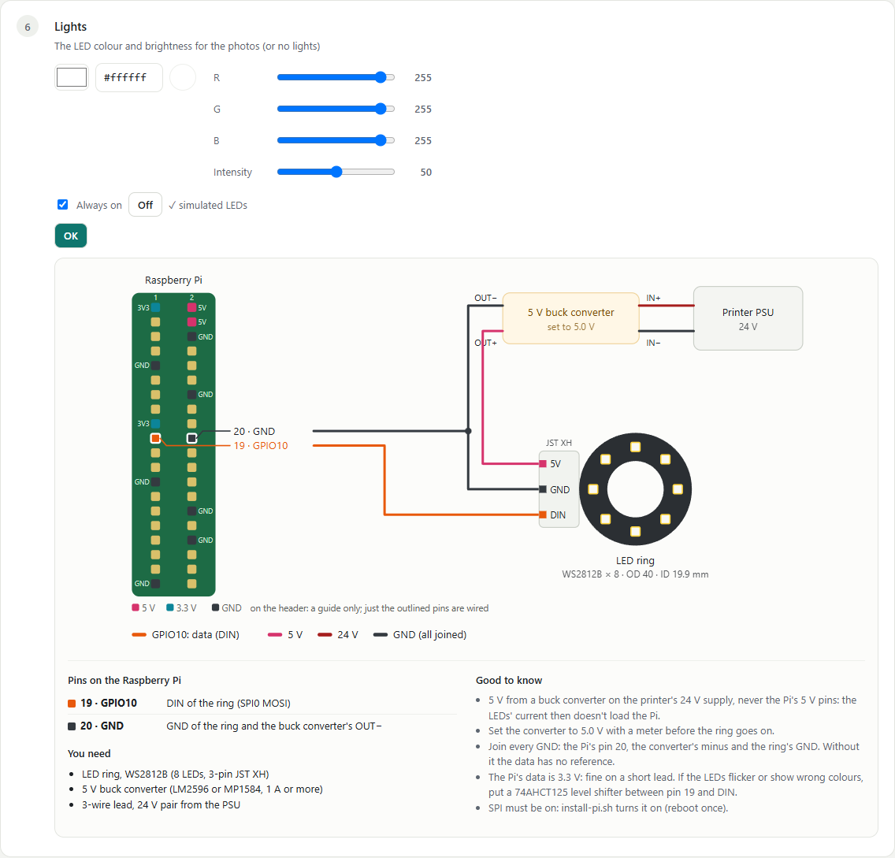
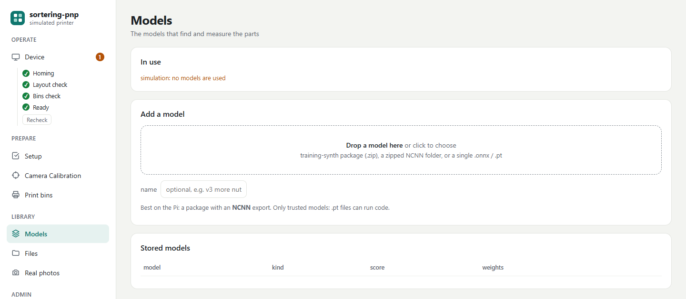
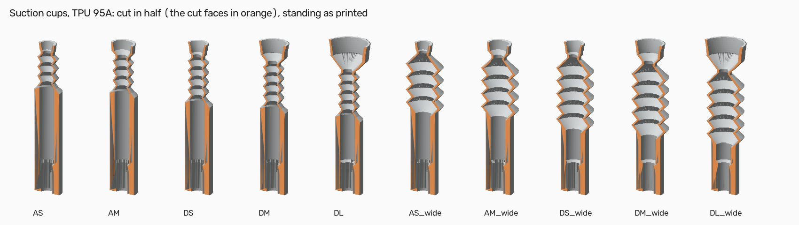
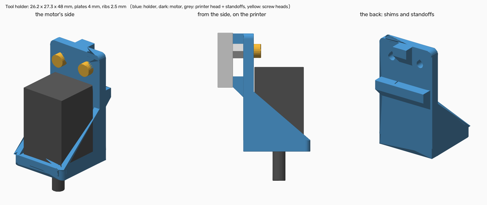

# sortering-pnp

**Turn a 3D printer into a screw sorter.** You throw a handful of screws, nuts and washers into a
tray on the printer bed. A camera looks at them, a trained model recognises each part (type, size
and length), and the printer picks them up one by one and drops each into its own bin.

sortering-pnp is the program that runs the machine. It lives on a Raspberry Pi next to Klipper (the
printer's firmware) and you use it from a web page on your phone or PC, or from the printer's own
display.


*The Device tab, the page you land on. On the left the sections of the page, the start-up check
(homing, layout, bins, ready) and, at the bottom, the machine's state and the STOP button. Top
right what runs (here automatic mode, paused) with only the buttons that apply. The camera shows
the latest photo with every part outlined and named and the next part boxed in red; the bed shows
every bin with what it collects and how full it is. Above the bed, on one line, the bins that need
you: D1 is full (amber, **Park**), A1 and E1 are finished (green, **Emptied**). Below, what lies
in the tray by class and length, and every step the machine takes. (Pictures from the built-in
simulator, which draws the bed instead of photographing it.)*

It is one of three projects that work together:

| Project | Runs on | Does |
|---|---|---|
| [screw-synth](https://github.com/ama24/screw-synth) | your PC | makes the training pictures, and the parts table that goes with them |
| [training-synth](https://github.com/ama24/training-synth) | your PC (GPU) | trains the model that recognises the parts |
| **sortering-pnp** (this one) | the Raspberry Pi | runs the machine: camera, decisions, printer, bins, web page |

The Raspberry Pi needs **only this one**. The projects only exchange files: the trained model
(from training-synth, for example as a download from its releases page) goes into sortering-pnp's
web page, and the camera calibration and real photos made here go back to screw-synth. Each
project works without the others.

### What's new

- **One install script does everything:** packages at exact versions, the Pi's pins (PWM for
  servos, SPI for the LEDs, the permissions for both) and Klipper's config.
  [Install](#install).
- **Lights:** an LED ring (WS2812B) on the Pi, with its colour and brightness set in the Setup
  tab, lit always or only for photos. [The lights](#the-lights).
- **Start-up check:** after every start the machine homes, finds the bins and looks into each one
  before it sorts, and ticks it off in the sidebar. Every start begins with an empty grid, so
  bins moved while it was off are found again.
- **Device tab shows what really runs:** a state chip (*Automatic · next look in 0:42*,
  *Sort once · sorting*, *Idle*), only the buttons that apply, and bin changes on one line above
  the bed with one **Park** / **Done** button.
- **Printed suction cups and a tool holder:** soft TPU cups for a 0.4 mm nozzle, in two bellows
  sizes, and an L bracket for the pneumatic tweezers' motor. [Printed parts](#printed-parts).
- **Washers by cup or magnet** are taken on their ring, not on the hole.
- **Gentle bed:** the bed (Y) ramps up slowly and never takes a corner at speed, so the parts in
  the tray stay where they are. Carrying a part lowers only the head's (X) acceleration.
- **Camera Calibration tab:** a live picture, one **Calibrate** button, *Skip for now*,
  rotate / mirror, and focus, white balance, exposure and image controls (kept inside what the
  sensor can do).

---

## Contents

- [How it works, in one minute](#how-it-works-in-one-minute)
- [What you need](#what-you-need)
- [Install](#install)
- [Klipper's config: what goes wrong](#klippers-config-what-goes-wrong)
- [First-time setup](#first-time-setup)
- [Everyday use](#everyday-use)
- [How it works, in more detail](#how-it-works-in-more-detail)
- [Real photos for checking the model](#real-photos-for-checking-the-model)
- [Updating](#updating)
- [On a PC](#on-a-pc)
- [More](#more)

---

## How it works, in one minute


1. **The bed.** A grid of [Gridfinity](https://gridfinity.xyz/) bins sits on the bed. One big bin,
   the **tray**, is where you throw the parts; the small bins around it receive the sorted parts.
   Every bin carries a small black-and-white code, so the camera finds the bins by itself, wherever
   you put them.
2. **A photo.** The camera above the bed takes a picture. Only the inside of the tray is shown to
   the model, so the bins around it can't confuse it.
3. **Recognising.** The model outlines every part and names it (for example `DIN912_M4`, a socket
   head screw M4). For screws it also measures the length (`DIN912_M4x16`).
4. **Deciding.** sortering-pnp counts what is in the tray and starts with the most numerous kind.
   Each kind goes to the bin you assigned it, or claims a free bin by itself.
5. **Picking.** The printer moves the picker (tweezers, a suction cup or a magnet) over the part,
   at the right angle, takes it, drops it into its bin and parks out of the picture for the next
   photo.
6. **Again**, until the tray is empty. Bins that are full or finished are shown on the page and on
   the printer display; you empty or swap them and the machine carries on.

---

## What you need

**Hardware**

- A **3D printer running Klipper** with Moonraker (e.g. an Ender 3 or a Prusa MK3 with MainsailOS
  or a KIAUH install). The hotend comes off; a **picker** goes on in its place, wired to the
  Raspberry Pi's own pins. Four kinds, chosen in the Setup tab:

  | Picker | Holds the part with | Aims at | Turns |
  |---|---|---|---|
  | **Servo tweezers** | a servo closing the tweezers | the centre of gravity (on the shank) | yes, a second servo, 0–180° |
  | **Suction cup** | a vacuum pump, switched by a MOSFET module | the head (a washer: its ring) | no |
  | **Magnet** | a servo pressing a magnet against an iron rod | the head (a washer: its ring) | no |
  | **Pneumatic tweezers** | a pump, switched by a MOSFET module | the centre of gravity | yes, a servo or a small stepper, 0–180° |
- A **Raspberry Pi 4 or 5** with 4 GB or more, running **64-bit Raspberry Pi OS** (Bookworm or
  Trixie). It runs Klipper, the camera, the model and the web page together.
- A **Raspberry Pi Camera Module 3** about 300 mm above the bed, looking straight down.
- Even **lighting** over the bed: an LED ring round the lens (WS2812B, e.g. the LumenPnP top ring,
  driven by the Pi) or an LED strip under a simple shroud.
- A **matte TPU sheet** (blue or green), cut to the tray's floor: parts don't bounce on it and the
  camera sees them clearly.
- A small **5 V buck converter** on the printer's 24 V supply for the servos and the LEDs (never
  the Pi's own 5 V pins).

**Printed parts** (all ready in [prints/](prints/), or made for your own layout in the page's
*Print bins* tab):

- a Gridfinity **baseplate** for the bed (thin versions that clamp to a whole Ender 3 or MK3 bed),
- the **tray** (3 × 3 or 4 × 4 cells) and **bins**, with their codes,
- a **camera arm** (plain, or with the LED ring round the lens) and a **screen holder** for
  the printer's top bar (for the Pi with a 7" screen),
- **suction cups** in TPU and a **tool holder** for the pneumatic tweezers (see
  [Printed parts](#printed-parts)).

See [prints/README.md](prints/README.md) for which files to print and how.

---

## Install

1. **Install Klipper, Moonraker and Mainsail.** Skip this if you flashed the MainsailOS image.
   On a fresh 64-bit Raspberry Pi OS:

   ```bash
   sudo apt-get install -y git
   git clone https://github.com/dw-0/kiauh.git ~/kiauh
   ~/kiauh/kiauh.sh
   ```

   In the menu choose **Install**, then **Klipper**, **Moonraker** and **Mainsail** (defaults
   are fine).

2. **Build the printer's firmware.** Find your board's example config; the settings to choose
   are at its top:

   ```bash
   ls ~/klipper/config | grep -i ender3
   ```

   Choose those settings, then build:

   ```bash
   cd ~/klipper && make clean && make menuconfig
   make
   ```

   - **32-bit board** (e.g. Creality 4.2.x): copy `out/klipper.bin` to an SD card and start the
     printer with it.
   - **8-bit board** (e.g. the Ender 3's 1.1.x): flash it over USB:

     ```bash
     sudo service klipper stop
     make flash FLASH_DEVICE=$(ls /dev/serial/by-id/* | head -1)
     sudo service klipper start
     ```

3. **Make printer.cfg.** For an Ender 3 with the 1.1.x board:

   ```bash
   cd ~/printer_data/config && mv printer.cfg printer.cfg.kiauh
   { echo "[include mainsail.cfg]"; cat ~/klipper/config/printer-creality-ender3-2018.cfg; } > printer.cfg
   ```

   Find the printer's port:

   ```bash
   ls /dev/serial/by-id/*
   ```

   In Mainsail (*Machine* tab), open printer.cfg and put that whole path after `[mcu] serial:`.

4. **Check the printer.** Mainsail shows *Ready*. In Mainsail's console:

   ```
   STEPPER_BUZZ STEPPER=stepper_x
   STEPPER_BUZZ STEPPER=stepper_y
   STEPPER_BUZZ STEPPER=stepper_z
   QUERY_ENDSTOPS
   ```

   Each motor moves; each switch is listed. Then home.

5. **Install sortering-pnp:**

   ```bash
   git clone https://github.com/ama24/sortering-pnp.git ~/sortering-pnp
   ~/sortering-pnp/install-pi.sh --service
   sudo reboot
   ```

6. **Check it:**

   ```bash
   ~/sortering-pnp/.venv/bin/sortering-pnp check
   ```

7. **Open the page** on your phone or PC and create an account:

   ```
   http://<your-pi>:8080
   ```

Something wrong? See the two tables below. What the install script does:
[docs/reference.md](docs/reference.md#installing-and-the-pinned-versions).

### Klipper's config: what goes wrong

Everything we ran into, with what to do. Mainsail's console shows Klipper's own message.
"Run `sortering-pnp klipper`" in the table means:

```bash
~/sortering-pnp/.venv/bin/sortering-pnp klipper
```

It fixes the first four itself and warns about the rest.

| You see | Why | Do |
|---|---|---|
| Two `[include sortering_pnp.cfg]` lines, or *Section 'gcode_macro TOOL_PICKER' already exists*-type errors | the include was added twice (an `echo >>` run twice) | run `sortering-pnp klipper`: it keeps one |
| Y homing is still fast | the include stands **before** `[stepper_y]`, so printer.cfg's `homing_speed` wins | run `sortering-pnp klipper`: it moves the include after your sections |
| *homing_override and safe_z_home cannot be used simultaneously* | printer.cfg has `[safe_z_home]`; sortering_pnp.cfg brings `[homing_override]` (Z homes over the plate, never over a bin) | run `sortering-pnp klipper`: it comments `[safe_z_home]` out |
| *Unable to open config file sortering_pnp_picker.cfg* | an older version put the picker in Klipper; it is on the Pi's pins now | run `sortering-pnp klipper`: it removes that include (the file can go too) |
| *Option 'step_pin' in section 'stepper_y' must be specified*, or a printer with no axes | printer.cfg is still **KIAUH's placeholder**; sortering_pnp.cfg only adds to your printer's sections | copy your printer's example into printer.cfg ([Install](#install), step 3), keep `[include mainsail.cfg]` as its first line, run `sortering-pnp klipper` |
| *mcu 'mcu': Unable to connect* | `[mcu] serial:` is empty, a placeholder (`<your-mcu-id>`) or `/dev/ttyUSB0` that moved | find the port as in [Install](#install) step 3, write that whole path, FIRMWARE_RESTART; the printer must be on |
| *SAVE_CONFIG section ... conflicts with included value* | a setting that SAVE_CONFIG writes (e.g. `[input_shaper]`, `[stepper_z] position_endstop`) was put in sortering_pnp.cfg | keep those in printer.cfg only; sortering_pnp.cfg has none of them |
| The tool variable is lost, or another program's saved variables are | two `[save_variables]` (Klipper keeps one file) | delete the one in printer.cfg (the warning says so) |
| No *Screw sorter* menu on the printer's screen | no `[display]` in printer.cfg (the Ender 3 V2's DWIN screen can't show Klipper menus) | optional: the web page does everything |
| *Unknown command: RESPOND* | no `[respond]` | sortering_pnp.cfg has it now: run `sortering-pnp klipper` |
| *Move out of range* when picking near the plate | the tip reaches lower than the nozzle did | `[stepper_z] position_min: -5` in printer.cfg (see [docs/reference.md#homing](docs/reference.md#homing)) |
| Endstops reversed (`QUERY_ENDSTOPS` says TRIGGERED with nothing pressed) | the example's pin polarity doesn't match your switch | add or remove `!` on that `endstop_pin:` in printer.cfg |
| Edits to `~/printer_data/config/sortering_pnp.cfg` disappear | the installer replaces it on every update (the old one: `.bak`) | put your changes in printer.cfg, or copy them over from `.bak` after an update |

Never edit printer.cfg's `#*#` block by hand: Klipper's SAVE_CONFIG writes it.

### When the Pi's pins or the camera complain

| You see | Do |
|---|---|
| *the Pi's pins cannot be used: Permission denied: /sys/class/pwm/...* | run the install script again, as in [Updating](#updating) (it adds the PWM udev rule), then reboot once |
| The page says PWM or SPI is missing | reboot once after the install: `config.txt` is read at boot |
| *settings drifted during capture: AnalogueGain ...* | update: sortering-pnp now keeps gain, exposure and focus inside what the sensor can do (the Camera Module 3 has no gain below 1.12) |

### Finding your way around the page

The sections are in the sidebar on the left, grouped by what you do:

| Group | Section | What it's for |
|---|---|---|
| Operate | **Device** | the machine live: camera, bed, what's in the tray, what it's doing. You land here. Under it, the start-up check. |
| Prepare | **Setup** | the steps to do once, in order, before the machine moves by itself |
| | **Camera Calibration** | the live camera, its settings, the calibration and what the model gets to see |
| | **Print bins** | the bins, trays, baseplates and holders to print |
| Library | **Models** | the models that find and measure the parts |
| | **Files** | files from the other projects (calibration, parts table) |
| | **Real photos** | photo sessions for checking the model on the PC |
| Admin | **Users** | who may use the page |

An orange number next to a section means it needs you (a bin to change, setup steps left). At
the bottom of the sidebar is the machine: its state, what it is doing, and **STOP**. On a phone
the sidebar becomes a bar across the top.

---

## First-time setup

Until the setup is complete, the machine only makes the moves you ask for on the Setup tab;
**Sort** and **Automatic** stay locked.

### 1. The Setup tab


Go through the eight steps once, in order:

1. **Printer:** sortering-pnp asks Klipper a few questions (is `sortering_pnp.cfg` included, is the
   hotend cold). Nothing moves.
2. **Homing:** press *Home now* and watch. sortering-pnp lifts the head first, then homes Z over the
   middle of the tray, never over a bin.
3. **Machine:** the bed limits, the travel height, the **photo position** (bed all the way out,
   head out of the picture) and the **picker-change position** (head high and in the middle).
   *Show me* drives to each so you can check. *Confirm* then sends the head to the
   picker-change position, ready for the next step.
4. **Picker:** choose yours and wire it as the page shows (see [The picker](#the-picker)).
   *Grab* and *Release* try it if you like. Put it on the head and press **OK**: from then on
   sorting may move it.
5. **Tip height:** put the tray on the bed under the tip (*Go to centre* shows
   where), then jog the tip down with the Z buttons on the same row onto the surface the parts lie on, with or without a TPU sheet,
   until a sheet of paper just drags, and press *Set height*. Every height sortering-pnp uses
   counts from here.
6. **Lights:** *Use lights* and pick the colour and brightness (shown live on the LEDs), or
   *No lights*. See [The lights](#the-lights).
7. **Camera to printer:** *Take photo* shows what the camera sees, with every code it reads
   circled and named (no model needed). Jog the tip onto the centre of three codes far apart,
   press *Tip is here* on each, then *Fit*. *Move tip here* goes back to a recorded point, to
   check it. Do the **camera calibration** ([step 3 below](#3-the-camera)) before it, or skip it
   for now.
8. **Layout:** *Find bins*: one photo finds the grid, every bin and which way it faces (see
   [step 2 below](#2-bins-on-the-bed)).

A step un-checks itself when something it depends on changes, so the setup can't silently go
stale.

### The picker


In the **Setup tab → Picker**, choose one of four (numbered in this order):

1. **Servo tweezers:** one servo opens and closes them, a second turns them up to 180°.
2. **Suction cup:** a vacuum pump, switched on and off by a MOSFET module.
3. **Magnet:** a servo presses a magnet against an iron rod; the rod's tip holds the screw. Steel
   only.
4. **Pneumatic tweezers:** a pump closes them, a servo turns them up to 180° (or a small stepper
   through a Klipper macro, `picker.rotate_macro`).

The cup and the magnet are put on the screw's **head**; a **washer** is taken on the middle of
its **ring** (between the hole and the outside, on the side away from its nearest neighbour),
since its centre is the hole. Both tweezers close at the **centre of gravity**, on the shank,
turned across the part.

Every signal comes from the **Raspberry Pi**, never from the printer's board, so the wiring is
the same on any printer. sortering-pnp switches the pins itself: nothing to set up in Klipper.
The page draws the wiring for the type you chose:

| Pi pin | Does |
|---|---|
| 32 (GPIO12) | grabs: the jaw servo, the magnet servo, or the MOSFET module's SIG (pump on/off) |
| 33 (GPIO13) | turns: the rotation servo (tweezers only) |
| 34 (GND) | joined with the ground of the 5 V converter, the MOSFET module and the 24 V supply |

Power comes straight from the printer's 24 V supply, as part of the conversion:

- **Servos:** run a pair of wires from the 24 V supply to the tip and put a small 5 V buck
  converter there, next to the servos. Never power them from the Pi's 5 V pin.
- **Pumps:** they run from the 24 V supply through the MOSFET module, with a diode across the pump.
  A logic-level module (AOD4184 / D4184) switches fully at the Pi's 3.3 V; the classic IRF520
  module only switches halfway.
- **Not the heater outputs:** don't take power from the bed or hotend heater outputs. Klipper
  switches them under its heater safety checks.

The page says whether the pins are ready. A pump is a plain on/off pin and needs nothing more.
Servos use the Pi's hardware PWM, which `install-pi.sh` turns on (reboot once after the first
install). Try *Grab* and *Release*, and for tweezers *Turn to 0°* and *90°*: at 0° the jaws must
close left–right; if they don't, set the offset. Parts are let go at the travel height; tick
*Lower over the bin before letting go* to go down to `drop_mm` above the bin's rim first
(`picker.lower_to_drop`). Then put the picker on the head (it waits at the picker-change
position) and press **OK**. Servo angles and pins can be changed in `configs/machine.yaml`
(`picker:`).

### The lights



An addressable LED ring (WS2812B, e.g. the 8-LED LumenPnP top ring, which the `camera_arm_ring`
print holds round the lens) lights the tray evenly. sortering-pnp writes to it over the Pi's SPI,
with nothing else to install:

| Pi pin | Goes to |
|---|---|
| 19 (GPIO10, SPI0 MOSI) | the ring's DIN |
| 20 (GND) | the ring's GND and the 5 V converter's minus |

The ring's 5 V comes from a buck converter on the printer's 24 V supply (set it to 5.0 V with a
meter first), not from the Pi. In the **Lights** step choose the colour (picker, hex or R/G/B)
and the intensity: the LEDs follow live. **Always on** keeps them lit while sortering-pnp runs;
off, they light only while a photo is taken. **No lights** completes the step without them. If
the LEDs flicker or show wrong colours, put a 74AHCT125 level shifter between pin 19 and DIN.

### 2. Bins on the bed


*The Print bins tab: each bin size has its own range of codes, so the camera knows a bin's size
from its code. The corner bins (codes 50–99) carry their code on a square post that goes straight
down to the floor, so no part can get trapped under it (best for the tray). The shelf bins
(codes 100–239) carry it on a shelf along the back. Below: baseplates, the holders for the top
bar and every bin of this layout.*

Print the baseplate, a corner tray (codes 90–94) and some bins (the *Print bins* tab, or the
ready-made files in `prints/`). Bins come as two-colour files: white bin, black code. With a
single-colour printer, add a colour change at the rim height.

Put the baseplate anywhere on the bed, the tray and the bins anywhere on it, turned any way.
Every time sortering-pnp starts it begins with an empty grid (5 × 5 cells, `bed:` in
machine.yaml), and the **start-up check** finds the bins: it homes, takes one photo of the bed
(the grid, every bin and which way it faces; the biggest bin becomes the tray), and looks into
each bin: a wild bin that already holds parts goes on collecting their kind, an empty one is
free. **Resync** (next to the bed on the Device tab) does the same at any time.


Each bin shows its grid name (A1 is front-left), its code, what it collects, how many parts went
in and a bar for how full it is. Click a bin (or its **⋯**, or right-click it) for its menu: ask
for it to be changed or park for it, edit its rules, make it the tray, turn it, mark it full or
emptied, print it, take it off the layout. A grey square is a cell without a bin; its ⋯ puts one
there.

Leave a bin without rules and it is **wild**: it is claimed by the first new kind of part that
needs a bin. A layout of only wild bins sorts by itself.

Changes are **queued**: they show dashed, a bar lists them, and **Apply** saves them all at once
(even while the machine sorts: they count from its next pick). **Discard** forgets them.
**Settings** next to Resync holds the grid size and what a wild bin collects (part, class or
family).
<br clear="right">

### 3. The camera


In the **Camera Calibration** tab:

1. **Camera:** the live picture from the camera, at the top. **Rotate 90°** / **Mirror** turn the
   picture (photos too); then do Camera to printer again. **Park bed** brings the bed out.
   Below it: focus (Auto, Manual lens position, or **Autofocus** once), white balance, exposure
   (shutter and gain), and brightness, contrast, sharpness and saturation, applied at once and
   kept. The picture starts turned 180° (`camera.hflip`/`vflip: true`), for a camera mounted the
   other way round.
2. **Calibration** teaches the program how the camera sees. Download and print the board
   (**Board PDF**), glue it flat on card, home the printer, empty the tray, then press
   **Calibrate**: one button. It parks the bed, locks the camera (measures the light and focus
   once and freezes them), then asks you to move the board slowly under the camera. Each time it
   holds still somewhere new, a photo is taken by itself, and the covered part of the live
   picture turns green. Then it asks you to lay the board flat in the tray, measures where the
   camera stands, and saves the result.
   **Skip for now:** enter the lens' height above the tray floor instead. The camera is then
   taken as looking straight down at the picture's centre; fine for trying things, less exact
   near the picture's edge. Calibrate later.
3. **Camera cropping:** the camera's picture next to what the model gets. Only the tray's inside
   goes to the model; the rest is painted over with one colour (the tray floor's own, or one you
   pick), the picture keeping its size. The bins and codes are always read from the whole photo.
   Set it once Camera to printer and the bins are done, and trim the edge with − / + until no
   wall is left.
4. **Camera to printer** is step 7 of the Setup tab: take a photo, jog the tip onto the centre
   of three codes, press *Tip is here* on each, then *Fit*. Now the program knows where every
   pixel is on the printer.

None of these needs a model: the photos only read the codes. The model is needed for sorting.

### 4. The model and the files



Download a trained model package (a `.zip` from training-synth, for example from its releases
page) and drop it in the **Models** tab. Every upload is kept in its own folder, so you can switch
back; one model is in use per role (finding the parts, measuring screws, classifying). The
package also brings the class list and the parts table it was trained with. On the Pi a package
with an NCNN export runs fastest.

The **Files** tab takes the other files sortering-pnp can use. Each card says where to find the
file, what it's for and what happens without it:


None of them is required: without a parts table, for example, bin fill is estimated from what the
camera sees.

### 5. The last checks on the real machine

The Setup tab ends with a list of things only you can do on the real machine (measure for the
camera arm, test the printer menu, print a corner bin…). Some tick themselves off when the
program notices; they never block sorting.


### Printed parts

Besides the bins and holders, [prints/](prints/) has the parts for the pickers:



- **Suction cups** ([prints/cups/](prints/cups/)), TPU 95A, made for a 0.4 mm nozzle: the folds
  and the lip are one line wide so they give, and every cup is 37 mm long, so swapping cups keeps
  the tip height. **A** tips (three folds, a cone lip) are for flat faces: pan, cheese and hex
  heads, nuts. **D** tips (four folds, a skirt flaring to a thin edge) follow curved and tilted
  faces. S, M and L are the lip sizes (about M2–M3, M3–M5, M5–M8); `_sieve` versions end in a
  dome with a ring of holes, so a part can't plug the cup and lets go at once. The `_wide` set
  has the same tips on a wider, softer bellows (about 3.5 times softer along the axis). Which
  cup for which part: [prints/cups/CUPS.txt](prints/cups/CUPS.txt).



- **Tool holder** ([prints/tool/](prints/tool/)) for the pneumatic tweezers' turning motor
  (NEMA 8 size, 20 × 20 × 30 mm): an L bracket that goes on the printer head's two M3 standoffs,
  with two shims behind it so a push on the tool levers against the head. The motor is held by
  4 × M2 × 5 from below. PETG or PLA, no supports.

Details in [prints/README.md](prints/README.md).

---

## Everyday use

1. **Throw the parts into the tray** and spread them a little with your hand.
2. Press **Start automatic** on the Device tab (or *Screw sorter → Automatic* on the printer's
   display). After a start, the start-up check runs first. The machine sorts until the tray is
   empty, then waits and looks again every minute (*next look in 0:42*, **Look now** to look at
   once): just keep throwing parts in. Under **Manual**, **Sort once** sorts what's there and
   stops, **One pick** takes a single part.
3. **Watch the Device tab** if you like: every photo as soon as it is taken, with the next part
   boxed, the bed, what lies in the tray (kept while the next photo is taken), and a line for
   everything the machine does (parking, taking a photo, running the model, picking X, leaving X
   in bin Y).
4. **When a bin is full**, or a new kind needs a bin and none is free, the bin turns amber and
   appears on the line above the bed (and on the printer's display). The machine **keeps sorting
   everything else**.
   - Press **Park**: the machine parks with the bed out, so your hands are safe.
   - Empty the bin, or put an empty bin in its place, and press **Done**. A photo checks what is
     there now (the same bin emptied, another bin, or nothing) and sorting goes on.
   - You can also ask for any bin to be changed from its ⋯ menu.
5. **Finished bins** (nothing left in the tray goes there) are green, with an **Emptied** button
   on the same line. Take them out, empty them and press it.
6. **STOP**, at the bottom of the sidebar, stops the printer at once.

Everything on the page can also be done from the printer's display: **Screw sorter** in its
menu has Automatic, Sort, One pick, Change bin, Pause, Resume and Stop.

---

## How it works, in more detail

**Seeing.** The camera photographs the whole bed. The bin codes are read from that photo. Then
everything outside the tray's inside is painted over with the tray floor's colour, and only that
goes to the model: it was trained on pictures of parts on a plain plate, at a fixed size per
millimetre, and the photo keeps exactly that size. The camera calibration turns pixels into
millimetres; the camera-to-printer fit turns those into printer coordinates.

**Choosing what to pick.** The first photo of a batch counts the parts by kind. The most numerous
kind goes first and is finished before the next one starts. If a kind that was already done turns
up again (dug out from under others), the machine goes back to it first. Within a kind, a part
with free space around it comes first, so the picker doesn't knock the others.

**Choosing the bin.** Bins with your rules come first (a part number like `DIN912_M4x16`, a class
like `DIN912_M4`, a family like `DIN912`, or wildcards). Then wild bins: each collects the first
kind that claims it. Unknown parts go to the *unknown* bin, parts the model isn't sure about to
*unsure*. When no bin is left, the machine asks for a bin change: it picks a bin whose kind is
finished or which is nearly full.

**Picking.** For a screw the model finds the top of the head, the underside of the head and the
tip, so sortering-pnp knows which way it lies, how long it is and where its centre of mass is
(the head's size comes from the parts table). Tweezers turn to close across the shank at that
point; a suction cup or a magnet goes onto the head, or onto a washer's ring. Other parts are
taken at the centre of their outline. If a pick fails (the part is still there on the next
photo) it tries again; if parts are stuck in a clump, it shakes the bed to spread them.

**Photo, pick, drop, park.** Each cycle the machine takes a photo with the head parked at the
photo position (at the travel height, so it never climbs higher than it must) and the picker
empty, picks the part chosen from it, leaves it in its bin and parks again for the next photo.

**Moving gently.** The tray rides on the bed, so the bed (Y) moves like a mill: low acceleration,
a straight ramp up to its speed, and no corners taken at speed (also when homing). While a part
hangs on the picker, only the head's (X) acceleration is lowered.

**How full the bins are.** Every part dropped adds its volume to the bin: the exact volume from
the parts table if you dropped one in the Files tab, otherwise an estimate from its outline and
height. Each bin's room comes from its size. Mark a bin that really is full as **Full** and the
machine learns how densely that kind of part packs.

**Safety.** Every move is checked against the bed limits and made at a safe height. The machine
refuses to move while the printer is printing, hot, not homed or carrying the hotend. Homing
always comes down over the tray, never over a bin. The picker is switched off on stop, error and
exit. And no other program sends moves.

---

## Real photos for checking the model


To see how well the model does on real parts, the **Real photos** tab takes sessions of real
photos: make a session, write down on the PC what lies in the tray, then take a photo after each
change. The bed is parked first, and the camera uses its locked settings. **Download** the session
and put it in screw-synth's `data/real/` on your PC.

---

## Updating

On the Pi:

```bash
cd ~/sortering-pnp && git pull && ./install-pi.sh --service
```

The install script brings everything to the versions this release was tested with, puts the new
`sortering_pnp.cfg` into Klipper (restarting it when something changed) and restarts
sortering-pnp. If it says so at the end, reboot once (new pin or SPI settings).

For a change in the program only, this is enough:

```bash
cd ~/sortering-pnp && git pull && sudo systemctl restart sortering-pnp
```

---

## On a PC

To try it without a printer (simulated printer, camera and parts), with Python 3.10 or newer:

```bash
git clone https://github.com/ama24/sortering-pnp.git && cd sortering-pnp
python3 -m venv .venv && . .venv/bin/activate   # Windows: .venv\Scripts\activate
pip install -e ".[dev]" opencv-contrib-python
sortering-pnp serve --sim
```

Open the address it prints. This is for a PC only: on the Pi use [install-pi.sh](#install).

---

## More

- **[docs/reference.md](docs/reference.md):** every tab, setting and rule in detail (homing with a
  longer picker, the tweezers' rotation axis, the head camera, models and their kinds, login and
  users, and so on).
- **[prints/README.md](prints/README.md):** which parts to print and how.
- **[configs/machine.yaml](configs/machine.yaml):** all settings, each with a comment.
- **Development:** set up as in [On a PC](#on-a-pc), then `pytest`, `ruff check .` and
  `ruff format --check .` before every commit. The code is in
  [src/sortering_pnp/](src/sortering_pnp/); [CLAUDE.md](CLAUDE.md) explains how it is built.
